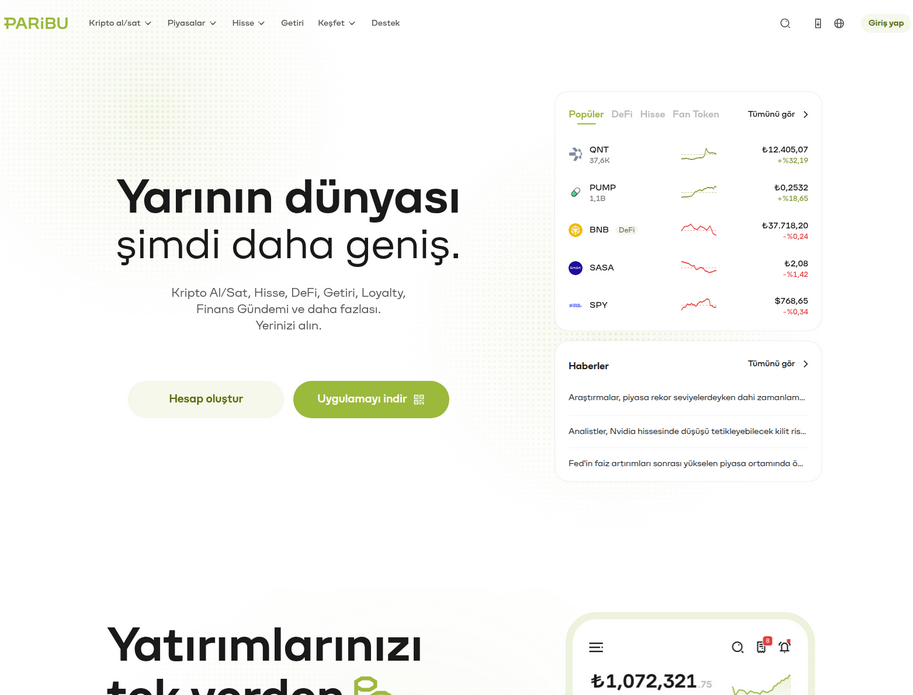
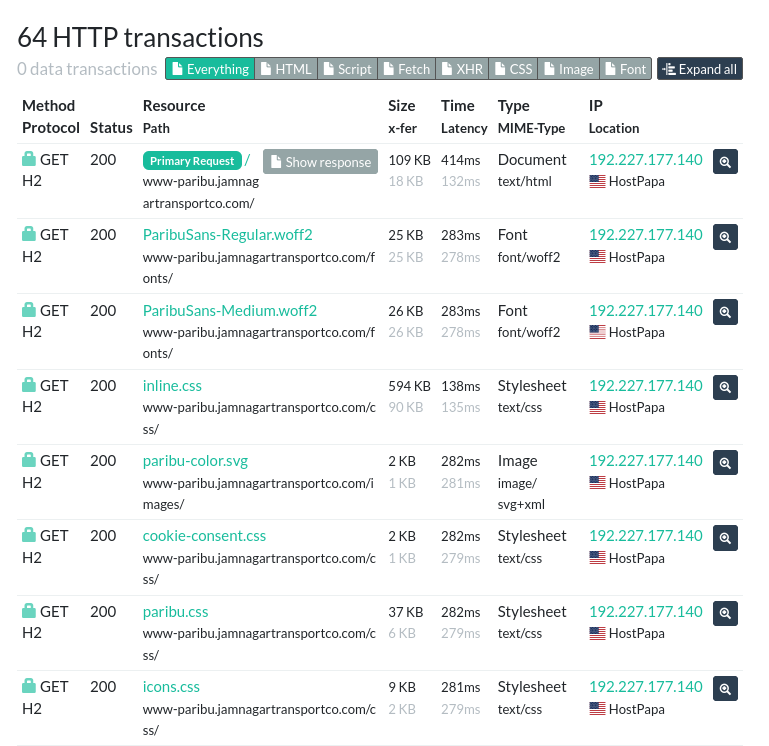
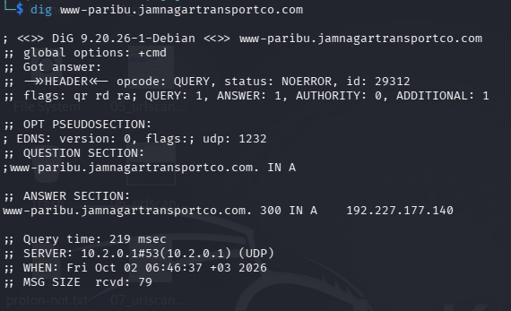
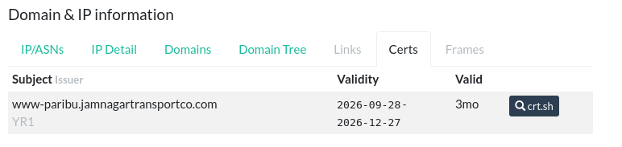
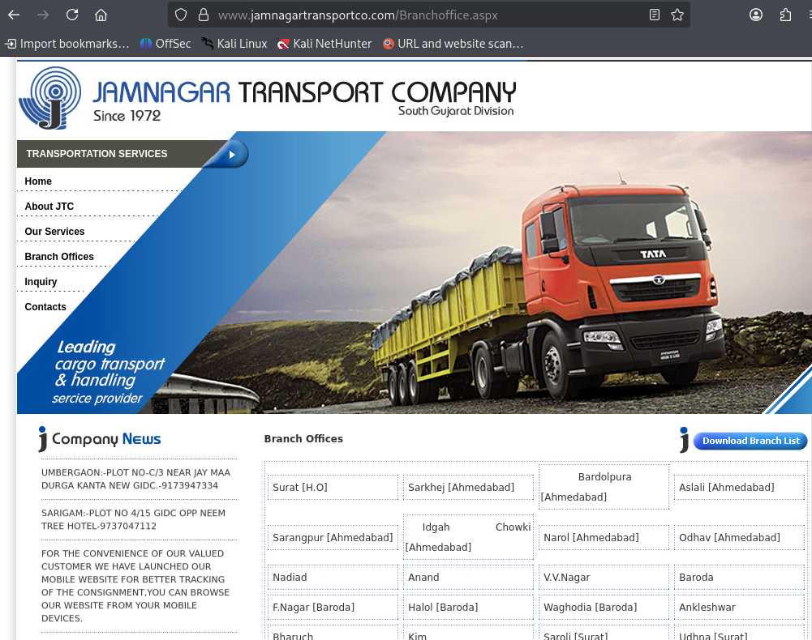
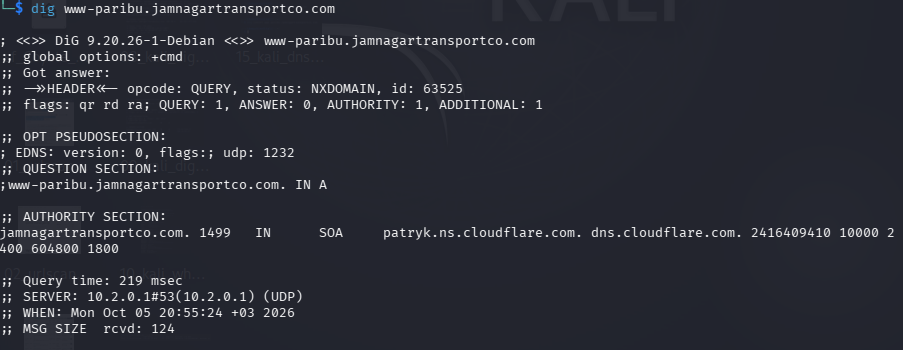

# Paribu Impersonation and Multi-Brand Phishing-Kit Infrastructure

**Author:** Coyot3Labs  
**Report date:** October 11, 2026  
**Evidence date:** October 1, 2026  
**Threat type:** Credential phishing  
**Impersonated brand:** Paribu  
**Status:** Confirmed phishing  
**Confidence:** High

- [Evidence index — 26 screenshots](evidence/INDEX.md)
- [Evidence review and exclusions](evidence/REVIEW_LOG.md)
- [Screenshot checksums](SHA256SUMS.txt)

## 1. Executive Summary

A phishing page impersonating the Turkish cryptocurrency platform Paribu was observed at:

`www-paribu[.]jamnagartransportco[.]com`

The page copied Paribu branding and used a global interaction handler that redirected every mouse click, touch event, and Enter or Space keypress to a local `login/` path. Exact resource-hash comparison with a scan of the legitimate Paribu website identified 35 matching resources, providing strong evidence that genuine brand assets had been copied.

The captured urlscan.io session contained 64 GET requests and no POST request. The login document was prefetched successfully, but the scanner did not interact with the page. The credential-submission and exfiltration endpoint therefore remain unobserved.

The page source referenced `webc[.]rankpilotlab[.]com`. Public urlscan.io records show that this host serves a multi-brand phishing framework used in LBank and OrangeX impersonation campaigns. The same framework exposed Paribu-specific login and redirect stylesheet resources.

No evidence links Paribu or Jamnagar Transport Company Private Limited to the operation. The parent domain may have been compromised or its subdomain may have been used without authorization.

## 2. Phishing Method

The landing page contained JavaScript that registered handlers for:

- `pointerdown`
- `mousedown`
- `touchstart`
- `click`
- Enter and Space keypresses

Every captured interaction called:

`window.location.href = 'login/'`

This behavior turns the complete landing page into a login redirect, regardless of which visible component the visitor selects.

The page also declared prefetch and prerender rules for:

- `login/`
- `login/index.html`

Both paths returned the same HTML object:

- **SHA-256:** `fdb502cb031e3a3d0889af0d34948a77048dabf6f3510b6f807dc4ce171e5722`
- **Response size:** 3,894 bytes
- **Last-Modified:** September 28, 2026 05:28:54 UTC

The login response body was not available in the exported scan data. No credentials were entered during the investigation.

*Figure 1 — Paribu-branded landing page rendered in the isolated urlscan.io capture.*

## 3. Content Comparison

The suspicious page loaded 55 hashed resources. Comparison with a contemporary scan of the legitimate Paribu website identified 35 exact SHA-256 matches.

The matches included brand images, fonts, and stylesheet content. Exact hash matches are stronger than visual similarity and demonstrate direct reuse of official site resources.

- [Suspicious urlscan.io result](https://urlscan.io/result/01a0f653-c554-7267-a803-7c6d14a840fc/)
- [Legitimate Paribu comparison scan](https://urlscan.io/result/01a0fb4f-8edd-7208-9600-795a659fae7b/)

Fourteen missing font and social-media image requests returned HTTP 404 errors. These errors are consistent with an incomplete website copy.

## 4. HTTP Observations

The exported urlscan.io data recorded:

| Observation | Value |
|---|---:|
| Total requests | 64 |
| GET requests | 64 |
| POST requests | 0 |
| Cookies | 0 |
| WebSocket connections | 0 |
| Domains contacted over HTTP | 1 |
| IP addresses contacted | 1 |

*Figure 2 — Captured HTTP transactions. The observed session contained GET requests only.*

The browser prefetched both login paths but did not navigate into the login workflow. The absence of a POST request only describes the captured session; it does not demonstrate that the login workflow lacked credential collection.

The main document response hash was:

`770ee61965b261fe57e78a2668621baaa00662c38bb24bc778974180dd1b95ba`

## 5. Network and TLS Infrastructure

### Phishing Host

| Field | Value |
|---|---|
| Hostname | `www-paribu[.]jamnagartransportco[.]com` |
| Observed IPv4 | `192[.]227[.]177[.]140` |
| ASN | AS36352 |
| ASN description | AS-COLOCROSSING / HostPapa |
| Location | Buffalo, New York, United States |
| PTR | `srv1[.]uwblue[.]com` |
| Web server | nginx |
| TLS protocol | TLS 1.3 |
| Certificate issuer | Let's Encrypt YR1 |
| Certificate valid from | September 28, 2026 06:19:38 UTC |
| Certificate valid until | December 27, 2026 |
| Certificate SHA-256 | `468f3e864d44eba29446f78ed1012edef58a297be9a6760cb0d0e1afebc52a9a` |

*Figure 3 — Historical DNS observation linking the phishing hostname to `192[.]227[.]177[.]140`.*

The phishing certificate became valid approximately three days before the urlscan.io observation.

*Figure 4 — TLS certificate subject and validity window shown by urlscan.io.*

The hostname currently returns NXDOMAIN. The parent domain continues to resolve through Cloudflare.

### Parent Domain

`jamnagartransportco[.]com` was registered on July 7, 2005. Its age differs from the short-lived phishing subdomain and certificate. This pattern supports, but does not prove, compromise or unauthorized subdomain provisioning.

WHOIS and RDAP data do not identify the person who created the phishing subdomain.

## 6. Multi-Brand Phishing-Kit Link

The Paribu landing-page source contained DNS prefetch and preconnect hints for:

`webc[.]rankpilotlab[.]com`

The Paribu homepage scan did not complete an HTTP request to this host. The source-code reference is therefore assessed together with independent public scans.

Public urlscan.io results show that `webc[.]rankpilotlab[.]com` served:

- `/lbank/login`
- `/orangex/login`
- `/api/hotsite-path-tokens`
- brand-specific Nuxt stylesheets and application components

The LBank scan also loaded these Paribu-specific files:

| Resource | SHA-256 |
|---|---|
| `ParibuLoginPage.B7B1Knvu.css` | `f5f77b36855b5023eb934ea8baa2d4f5a4e2969d7eb05c7a3bdba502cef5ef77` |
| `ParibuRedirectToLogin.D94fGj4F.css` | `f2f1c7c5d38abd13f922ee3ad957caae396766ac3f936b13d56bf76a0884f0b1` |

Related public observations:

- [OrangeX impersonation, September 15](https://urlscan.io/result/01a0a460-987e-762b-81db-991546966672/)
- [OrangeX impersonation, September 20](https://urlscan.io/result/01a0c11d-5742-72f9-a170-4ed99b659431/)
- [LBank impersonation, October 9](https://urlscan.io/result/01a12122-1e89-737f-87ff-f7ff993637bb/)
- [LBank impersonation, October 9](https://urlscan.io/result/01a12193-bbab-732d-b810-6a4fb5f3fbb4/)

The related landing pages also used AS36352, although they resolved to different addresses. A shared ASN alone is insufficient for attribution; the central kit host and brand-specific resources provide the stronger relationship.

Certificate Transparency records show certificates for `webc[.]rankpilotlab[.]com` on September 2, 25, and 28, 2026. Later certificates included authentication-themed names such as `oauthv1`, `oauthv2`, `googl-login`, `lgn`, and `log-in`.

The evidence supports high-confidence association with the same phishing-kit infrastructure. It does not identify a specific human operator.

## 7. Company Identity Assessment

India's Ministry of Corporate Affairs records Jamnagar Transport Company Private Limited under CIN `U63090GJ1999PTC035330`, incorporated on January 25, 1999.

The company's existence does not establish control of the phishing hostname. No evidence indicates that the company participated in the campaign or had a legitimate relationship with Paribu.

*Figure 5 — Parent-domain content used for the company-identity comparison.*

A WHOIS screenshot for `jtcltd[.]com` was excluded from attribution because it concerns a different domain.

## 8. Timeline

| Time (UTC) | Event |
|---|---|
| September 28, 2026 00:45 | Certificate issued for `webc[.]rankpilotlab[.]com` and related kit hosts |
| September 28, 2026 05:13–05:48 | Paribu clone files show deployment timestamps |
| September 28, 2026 06:19 | Phishing hostname certificate becomes valid |
| October 1, 2026 07:18 | urlscan.io captures the Paribu page |
| October 2, 2026 | Phishing hostname still resolves |
| October 5–11, 2026 | Phishing hostname returns NXDOMAIN |

The close timing of the kit certificate, cloned files, and phishing certificate supports coordinated deployment.

*Figure 6 — Later DNS check showing that the phishing hostname no longer resolved.*

## 9. Confidence Assessment

| Assessment | Confidence |
|---|---|
| The page impersonated Paribu | High |
| The landing page forced visitors into a login path | Confirmed |
| `rankpilotlab[.]com` served multi-brand phishing-kit components | High |
| The Paribu page was associated with that kit infrastructure | High |
| The parent domain was compromised or misused | Medium |
| The LBank and OrangeX pages used the same kit family | High |
| All deployments were operated by the same individual | Insufficient evidence |
| Credentials were successfully exfiltrated | Not observed |
| Jamnagar Transport Company participated in the campaign | No evidence |

## 10. Indicators of Compromise

See [paribu.csv](ioc/paribu.csv) for the machine-readable indicator list.

Primary indicators:

- `www-paribu[.]jamnagartransportco[.]com`
- `192[.]227[.]177[.]140`
- `webc[.]rankpilotlab[.]com`
- `rankpilotlab[.]com`

AS36352, Cloudflare infrastructure, and the parent domain should not be blocked solely on the basis of this report. These resources may be shared or contain legitimate services.

## 11. Evidence Integrity

| Artifact | SHA-256 |
|---|---|
| Evidence ZIP | `BA321EEFD57E96A5DC593EF686FE1F8917096449ED79AD54FCF9615A4C582A9A` |
| Exported urlscan.io JSON | `C5A3D3738162F7BB736011B64641B852828062E87FB7E5705A562D8E4CA3E2D8` |
| Captured landing-page HTML | `ABE539D1AEA9429C078137D3AF7FE06945144ABAAB96D6C5F4DC5747C8D8F5B9` |

Selected, reviewed screenshot copies are available in [the evidence index](evidence/INDEX.md). The complete original archive remains local. Screenshot checksums identify the byte-for-byte publication copies.

## 12. Sources and Tools

- urlscan.io
- Verisign RDAP
- Certificate Transparency logs
- Google Public DNS
- WHOIS
- dig
- Subfinder
- Team Cymru IP-to-ASN
- India Ministry of Corporate Affairs

## Disclaimer

This investigation was conducted for defensive cybersecurity research and threat-intelligence purposes. The phishing site was not accessed through a personal browser, and no credentials or personal information were submitted.

Domains, URLs, and IP addresses in the written analysis are defanged. Screenshots preserve the original captured interface and may display active-looking indicators; do not visit them directly.
