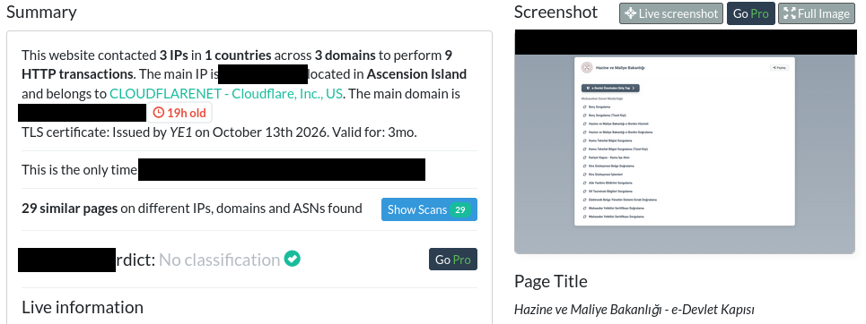
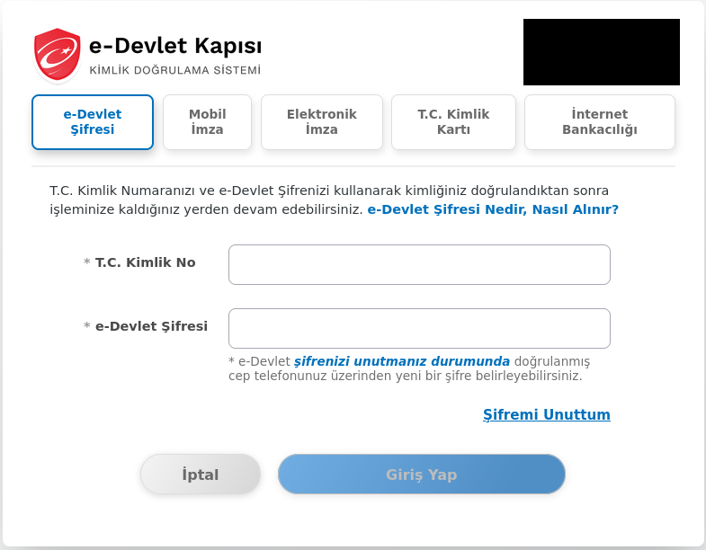
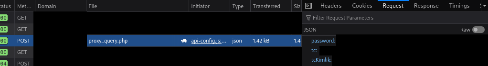
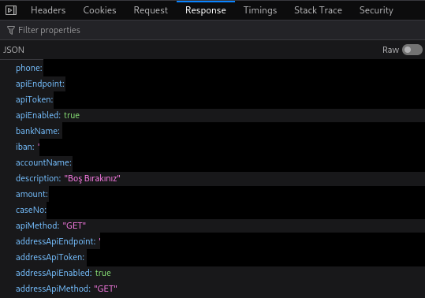
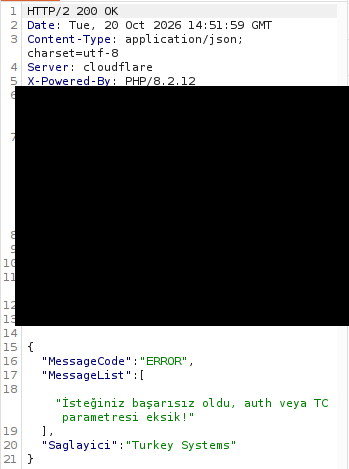
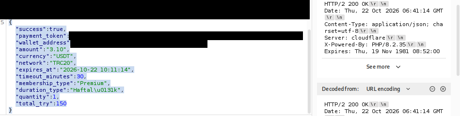
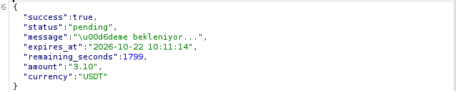
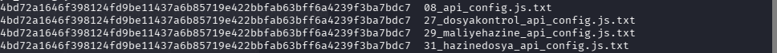

# CASE002 — e-Devlet and Treasury Impersonation: Credential Collection and External API Configuration

**Author:** Coyot3Labs  
**Report date:** October 24, 2026  
**Visual evidence update:** October 25, 2026  
**Primary observation window:** October 13–22, 2026  
**Assessment:** High-confidence phishing; current availability unverified  
**Scope:** Offline review of the 35 files in `CASE002_evidence.zip`.

## Executive Summary

`ehazinesorgula[.]com` displayed pages impersonating Turkey's Ministry of Treasury and Finance and the e-Devlet government portal. Its login form requested a Turkish national identity number and password. A browser screenshot shows these fields being POSTed to a proxy on the same site; the supplied source code supports this collection path. **The phishing assessment is high confidence.** [E03, E05, E07, E08, E10]

Client-visible settings referenced `turkeysystems[.]org/tc-api`. The archive does not demonstrate a successful person lookup or a completed transfer from the phishing session to that external service. Four locally saved JavaScript files are byte-identical, but independent acquisition from all four attributed domains is not fully documented. A common operator, victim count, completed payment, and present-day activity cannot be established. [E08, E11, E14, E27, E30, E32, E34]

*E01 — Cropped urlscan summary. Live addresses and account context are removed; the historical scan is not a current-status check.*

## Phishing Method

| Stage | Evidence-supported finding |
|---|---|
| Government impersonation | Ministry branding and debt/public-service links direct visitors to `./giris`. [E03: lines 348–407; E05] |
| Credential collection | The form passes the identity number and password to `queryUserDataFromApi`. E10 shows a same-site POST with `tc`, `tcKimlik`, and `password` fields. Their values are omitted. [E07: lines 448–486; E08: lines 99–107; E10] |
| Runtime configuration | The script reads `./settings.json` and falls back to local settings if retrieval fails. E11 shows enabled external API and address-query settings. E08's empty/disabled defaults alone do not establish runtime behavior. [E08: lines 13–68; E11] |
| Proxy and direct fallback | The first path is a POST to `./api/proxy_query.php`. The direct fallback can send identity/password fields in POST mode; GET mode appends a `tc` parameter. Authorization headers are added if a key is configured. E11 shows GET mode. External transmission of the password is not proven. [E08: lines 95–162; E11] |
| Fabricated case/debt context | When an API query fails, the code can generate a case number from the identity input and construct default case/debt data. A local authenticated-session flag is not evidence of genuine e-Devlet authentication. [E08: lines 311–390; E07: lines 466–523] |

*E05 — Government-portal impersonation with empty identity/password fields. Browser and live-address context are removed.*

*E10 — Same-site POST to proxy_query.php with password, tc and tcKimlik field names. Every value is masked; no response body is shown.*

The initial delivery channel—email, SMS, advertising, or another route—is absent from the archive. Captured inputs cannot be independently classified as real victim data or analyst test data.

## Network and Infrastructure Analysis

### Captured traffic versus screenshots

The E09 HAR, an HTTP traffic archive, contains **20 requests: 18 GETs and two POSTs**, recorded on October 18, 2026, at 08:54:43–08:54:44 `+03:00`. Both POSTs target `/cdn-cgi/rum` and contain telemetry. The HAR contains no credential POST, no request to `proxy_query.php`, and no request to the external API. The credential-bearing POST is evidenced by screenshot E10; it is not attributed to the HAR session.

The UTF-8 response bytes for `/api-config.js?v=2` in HAR entry 5 exactly match E08. This supports the primary domain's script provenance. The `/giris` entry records HTTP 304 while also retaining a body, so its cached-response context must be preserved. [E09]

*E11 — Client-visible configuration: keys, enabled flags and GET methods remain; endpoint, identity, secret and payment values are masked.*

| Observation | Interpretation and limit |
|---|---|
| Primary-domain address: `104[.]21[.]22[.]92`; HAR address: `2606[:]4700[:]3034[:][:]6815[:]165c`. [E01, E09] | Cloudflare edge addresses, not a discovered origin server. IPv6 colons are defanged as `[:]`. |
| External-service A records: `104[.]21[.]1[.]166`, `172[.]67[.]129[.]163`; AS13335. [E18–E20] | The DNS screenshot is undated. Shared CDN addresses and ASN membership do not establish a common operator or justify blanket blocking. |
| E17 shows dated NXDOMAIN; E18 shows A records. | The exact queried spelling in E17 could not be established confidently from the image. These records do not establish a takedown or explain a DNS change. |
| `/tc-api` returns HTTP 200 with JSON `MessageCode: ERROR`. [E14] | A missing-parameter error, not evidence of a successful identity lookup or access to an identity database. |
| External-service membership payment creation and a later `pending` response. [E25–E27] | Analyst-interaction evidence, not proof of a transfer, phishing-victim payment, or campaign revenue. |

*E14 — HTTP 200 with application-level ERROR for missing parameters. This is not a successful identity lookup.*

Cloudflare and Umami telemetry resources are not classified as malicious IoCs. Port responses in E16 and directory-discovery output in E21 do not establish server-side content or an origin address.

### Timeline

| UTC | Evidence record |
|---|---|
| 2026-10-13 09:38:56 | Primary-domain WHOIS creation time; not the start of phishing activity. [E23] |
| 2026-10-13 11:24:43 | urlscan[.]io landing-page scan with nine HTTP transactions. [E01–E02] |
| 2026-10-18 05:54:43–05:54:44 | Separate login-page HAR session. [E09] |
| 2026-10-20 14:51:59 | HTTP Date in the external API's error response; not necessarily the collection time. [E14] |
| 2026-10-22 06:41:14 | HTTP Date in the payment-creation response; the later check reports `pending`. [E26–E27] |

E24 shows Let's Encrypt YE1 and Sectigo E36 certificate records beginning October 13 and October 15 respectively. The second result is labeled **precertificate**. This does not prove that both certificates were served simultaneously or that the site's content was trustworthy. Full certificates are absent.

### Payment interaction excerpts

*E26 — Membership payment request for 3.10 USDT/TRC20. The payment token and wallet are masked; creation is not settlement.*

*E27 — The following status response remains pending. A completed transfer or phishing-victim payment is not established.*

### Shared-component assessment

E08, E30, E32, and E34 are identical **18,469-byte** copies. Their filenames attribute E30/E32/E34 to `dosyakontrol[.]net`, `maliyehazine[.]com`, and `hazinedosya[.]com`. E29 shows the same script path on the first candidate. Independent response acquisition from all candidate domains is not fully documented. Byte equality is confirmed; deployment across four domains and a common operator remain unproven. [E28–E35]

*E35 — Four local script copies share the same SHA-256. This proves local byte identity, not independent four-domain acquisition or a common operator.*

`gibtakip[.]net` and `gibbelgesorgula[.]com` are filename-search candidates only. They are excluded from the confirmed-phishing indicator category. See [pivots.csv](pivots.csv).

## IoC List

Indicators are listed with their roles. An external API relationship does not by itself establish that the entire external domain is malicious.

| Indicator | Role / confidence | Evidence |
|---|---|---|
| `ehazinesorgula[.]com` | Observed phishing domain / high | E01, E03, E05, E10 |
| `hxxps[://]ehazinesorgula[.]com/giris` | Fake login path / high | E05–E09 |
| `hxxps[://]ehazinesorgula[.]com/api/proxy_query.php` | Same-site credential-submission path / high | E08, E10 |
| `turkeysystems[.]org` | Configured external API relationship / high for that relationship; successful transfer unverified | E11, E14 |
| `hxxps[://]turkeysystems[.]org/tc-api` | Configured query endpoint / high; query secrets omitted | E11, E14 |
| `4bd72a1646f398124fd9be11437a6b85719e422bbfab63bff6a4239f3ba7bdc7` | SHA-256 of the `api-config.js` component / high for byte identity; not a whole-kit hash | E08, E09, E30, E32, E34 |

Machine-readable indicators: [iocs.csv](iocs.csv). Candidate pivots: [pivots.csv](pivots.csv). Cloudflare IP addresses are retained as infrastructure context and excluded from standalone malicious IoCs.

## Evidence Handling and Limitations

All **35 files** were reviewed: 27 PNGs, seven text files, and one HAR. There are **32 unique byte contents**. E06 is a browser view-source wrapper; after extracting its displayed source and normalizing HTML entities and whitespace, it matches E07. These are overlapping representations, not independently corroborating acquisitions.

Raw evidence contains or may expose passwords, API secrets, identity-shaped inputs, personal/contact/bank information, payment tokens, a wallet address, and analyst-environment details. Transparent terminal backgrounds expose sensitive content in several screenshots. **Raw originals remain private. This release adds 27 reviewed screenshot derivatives and reproduces no sensitive values.** Static template data is not classified as verified victim information. Retained pixels are unchanged except for documented opaque black masks; cropping removes irrelevant or sensitive areas. No generative reconstruction, blur, or substituted evidence text was used. E12 required only metadata-stripped RGB re-encoding. Some excerpts are deliberately narrow and their captions identify what is no longer visible.

The [screenshot gallery](evidence/INDEX.md) includes all 27 reviewed copies. The [redaction log](evidence/REDACTION_LOG.md) and [derivative manifest](evidence/DERIVATIVES.json) map each copy to its original evidence ID, hashes and exact crop/mask coordinates.

Evidence IDs, original filenames, sizes, SHA-256 hashes, findings, sensitivity categories, and publication decisions are recorded in [evidence_index.csv](evidence_index.csv). The concise audit and outstanding gaps are in [AUDIT.md](AUDIT.md). Publication-file checksums are in [SHA256SUMS.txt](SHA256SUMS.txt).

This was an offline review. Current availability was not tested during either offline review. Operator identity, victim counts, successful external data transfer, and completed payments were not verified. Raw acquisition logs, complete scan JSON, server-side proxy code, and independently recorded responses for each candidate domain are missing.
