# Reviewed screenshot gallery

**Publication review:** 25 October 2026. All 27 source screenshots are represented below by reviewed publication copies. Originals remain private. The main report embeds eight selected illustrations.

Black rectangles are irreversible opaque pixel replacements, not blur. Some images are cropped to narrow safe excerpts; captions distinguish what is retained from observations made from the private original. E12 required no pixel masks or crop and was re-encoded without metadata. No evidence text was generated or replaced. Domain/IP/URL values are masked in images and stated only in defanged text where relevant.

See the [redaction log](REDACTION_LOG.md), [exact transformation/hash manifest](DERIVATIVES.json), [35-file inventory](../evidence_index.csv), and [main report](../README.md). Source hashes identify the received files; they do not independently authenticate historical acquisition.

| Evidence | Publication copy |
|---|---|
| E01 | [01_urlscan_summary.png](screenshots/E01_urlscan_summary_redacted.png) |
| E02 | [02_urlscan_http_resources.png](screenshots/E02_urlscan_http_resources_redacted.png) |
| E04 | [04_urlscan_similar_domains.png](screenshots/E04_urlscan_similar_domains_redacted.png) |
| E05 | [05_fake_edevlet_login.png](screenshots/E05_fake_edevlet_login_redacted.png) |
| E10 | [10_credential_post_request.png](screenshots/E10_credential_post_request_redacted.png) |
| E11 | [11_api_settings.png](screenshots/E11_api_settings_redacted.png) |
| E12 | [12_burp_turkeysystems_login_response.png](screenshots/E12_burp_turkeysystems_login_response_redacted.png) |
| E13 | [12_proxy_request_code.png](screenshots/E13_proxy_request_code_redacted.png) |
| E14 | [13_burp_turkeysystems_tc_api_response.png](screenshots/E14_burp_turkeysystems_tc_api_response_redacted.png) |
| E15 | [13_external_api_fallback_code.png](screenshots/E15_external_api_fallback_code_redacted.png) |
| E16 | [13_http_port_comparison.png](screenshots/E16_http_port_comparison_redacted.png) |
| E17 | [14_external_api_dns_nxdomain.png](screenshots/E17_external_api_dns_nxdomain_redacted.png) |
| E18 | [15_external_api_dns.png](screenshots/E18_external_api_dns_redacted.png) |
| E19 | [16_external_api_asn.png](screenshots/E19_external_api_asn_redacted.png) |
| E20 | [17_external_api_second_asn.png](screenshots/E20_external_api_second_asn_redacted.png) |
| E21 | [18_gobuster_directory_discovery.png](screenshots/E21_gobuster_directory_discovery_redacted.png) |
| E22 | [19_virustotal_historical_whois.png](screenshots/E22_virustotal_historical_whois_redacted.png) |
| E23 | [20_virustotal_ehazine_dns_whois.png](screenshots/E23_virustotal_ehazine_dns_whois_redacted.png) |
| E24 | [21_censys_ehazine_certificates.png](screenshots/E24_censys_ehazine_certificates_redacted.png) |
| E25 | [22_burp_turkeysystems_payment_endpoints.png](screenshots/E25_burp_turkeysystems_payment_endpoints_redacted.png) |
| E26 | [23_burp_crypto_payment_response.png](screenshots/E26_burp_crypto_payment_response_redacted.png) |
| E27 | [24_burp_crypto_payment_pending.png](screenshots/E27_burp_crypto_payment_pending_redacted.png) |
| E28 | [25_urlscan_phishing_kit_candidates.png](screenshots/E28_urlscan_phishing_kit_candidates_redacted.png) |
| E29 | [26_urlscan_dosyakontrol_shared_js.png](screenshots/E29_urlscan_dosyakontrol_shared_js_redacted.png) |
| E31 | [28_sha256_shared_phishing_kit.png](screenshots/E31_sha256_shared_phishing_kit_redacted.png) |
| E33 | [30_sha256_three_domain_match.png](screenshots/E33_sha256_three_domain_match_redacted.png) |
| E35 | [32_sha256_four_domain_match.png](screenshots/E35_sha256_four_domain_match_redacted.png) |

## E01

urlscan summary excerpt for ehazinesorgula[.]com: 9 HTTP transactions and an institution-themed page preview. The scan record reports 13 October 2026 11:24:43 UTC; the timestamp is outside this crop.

**Edits:** Cropped away the site/account header, submitted URLs and live-DNS panel. Opaque masks remove remaining live domain/IP strings and the miniature page header. No text was reconstructed.

**Limit:** Historical scan summary, not current availability. Cloudflare edge attribution does not identify the origin or operator; the embedded page preview is small.

## E02

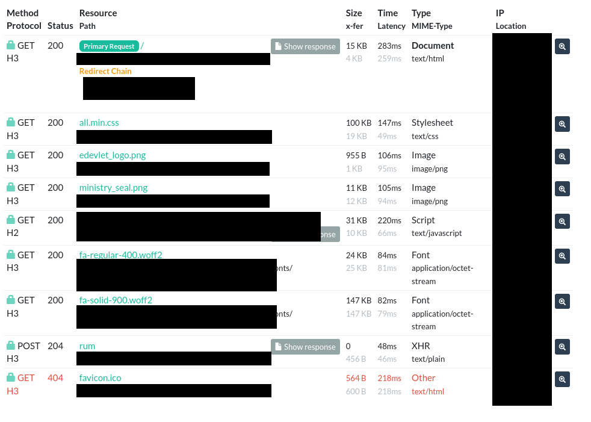

urlscan HTTP-resource list: successful page/assets requests, a 404 favicon request and a POST to Cloudflare /cdn-cgi/rum returning 204.

**Edits:** Opaque masks remove raw domain/URL/IP values, secondary resource paths and an unnecessary script identifier. Request methods, status codes and useful resource names remain.

**Limit:** The POST shown is telemetry, not a credential submission or evidence of successful exfiltration.

## E04

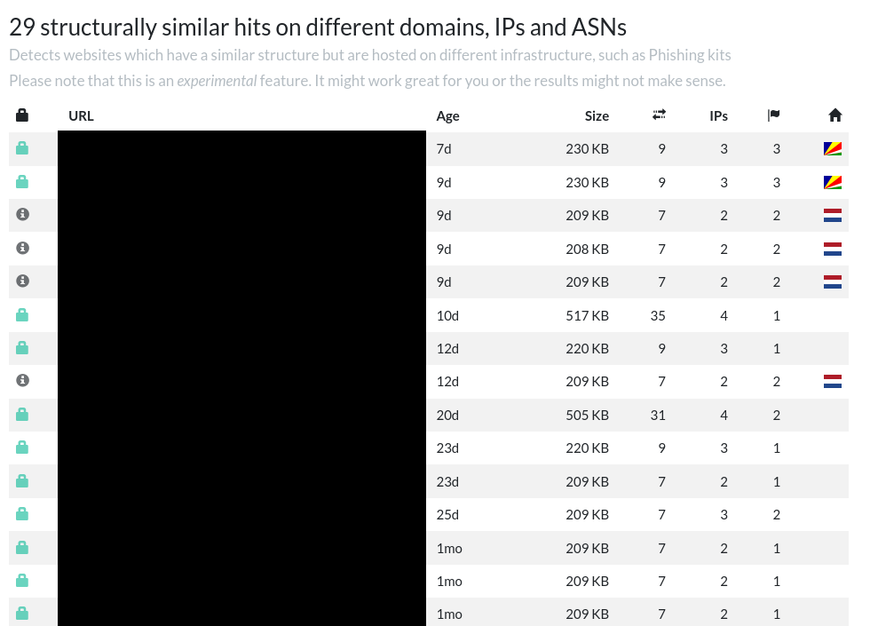

urlscan reports 29 structurally similar hits. Candidate-domain labels are removed; the experimental-feature warning and part of the results table remain.

**Edits:** Cropped away the live effective URL and submission header; an opaque mask removes the candidate URL column.

**Limit:** Only part of the results list is visible. Structural similarity does not establish shared content, a common operator or maliciousness.

## E05

Fake e-Devlet login appearance with empty Turkish national ID and password fields, originally shown at ehazinesorgula[.]com/giris.

**Edits:** Cropped away browser chrome, bookmarks, the live address and footer. An opaque mask removes the domain/URL displayed in the upper-right imitation branding.

**Limit:** The fields are empty. This image shows impersonation and collection intent, not a form submission or successful transfer. The source address is outside the crop.

## E10

DevTools screenshot shows a selected POST to proxy_query.php with request fields password, tc and tcKimlik. All values are removed.

**Edits:** Cropped away browser/account panels and unrelated traffic. Opaque masks remove the domain column, non-selected request details and every credential/identity value.

**Limit:** Screenshot-only evidence of the same-site POST; this POST is absent from E09 HAR. No response body or completed external API transfer is shown, and test-data status is unverified.

## E11

Client-visible settings response retains field names, enabled flags and GET methods. Endpoint, secret, identity, contact and payment values are removed.

**Edits:** Cropped to the response panel, excluding the account header and network table. Opaque masks remove phone, API endpoint/token values, bank/account/IBAN details, amount, case value and address API endpoint/token values.

**Limit:** The original configures turkeysystems[.]org/tc-api; this derivative hides endpoint values. Configuration does not prove a successful identity lookup, password transfer or payment.

## E12

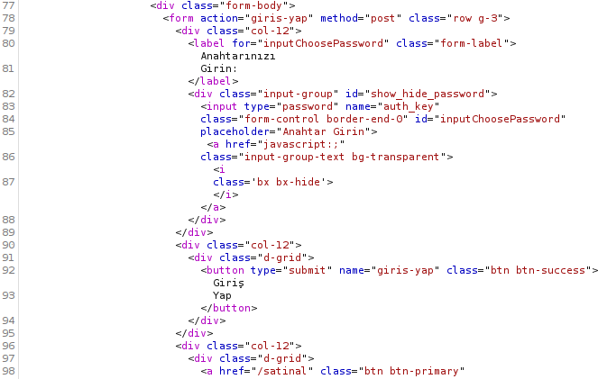

HTML excerpt shows a POST login form with action giris-yap and a password input named auth_key; no entered key is visible.

**Edits:** No pixel masks or crop required after review; publication uses a metadata-stripped re-encoded derivative.

**Limit:** Host, URL and HTTP status are absent from the original image. The service attribution in its filename is not independently verified by this excerpt.

## E13

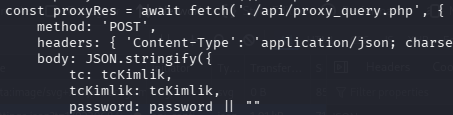

Narrow static-code excerpt shows the local ./api/proxy_query.php fetch, POST method and JSON identity/password field names.

**Edits:** Cropped to the request-code lines. The entire account/settings area containing translucent secret and personal-data residues is outside the crop; no sensitive values were reconstructed.

**Limit:** The crop truncates longer code lines and omits fallback/error handling. Static code does not establish server proxy contents or a completed external API transfer.

## E14

Response excerpt: HTTP 200 with JSON MessageCode ERROR stating that auth or national ID parameters are missing; server Date is 20 October 2026 14:51:59 GMT.

**Edits:** Cropped away the request/client panel. An opaque mask removes telemetry URLs and request tracking/timing identifiers while retaining status, basic response headers and the application error.

**Limit:** The original is an analyst request to turkeysystems[.]org/tc-api. HTTP 200 is not successful identity lookup; server Date does not establish acquisition time. The host is outside the crop.

## E15

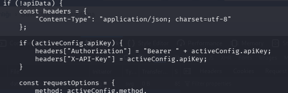

Fallback-code excerpt conditionally adds Authorization and X-API-Key headers and takes the request method from configuration; no key value is present in the retained code.

**Edits:** Narrow crop excludes the account header and the entire lower settings area containing translucent API secrets, personal identifiers, phone and bank data.

**Limit:** The retained crop omits request-body construction, GET URL construction and response handling. Code capability does not prove that this fallback executed.

## E16

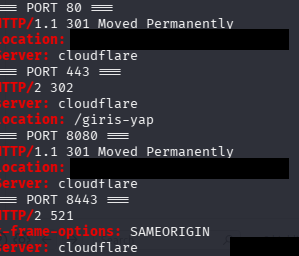

Port-response comparison excerpt: 80/8080 return 301, 443 redirects to /giris-yap and 8443 returns Cloudflare 521. Original target: turkeysystems[.]org.

**Edits:** Cropped away commands and the unrelated transparent response background. Opaque masks remove live Location URLs and a residual interface fragment.

**Limit:** Historical analyst probes against a Cloudflare edge; these responses do not identify the origin server or prove a working application on 8443.

## E17

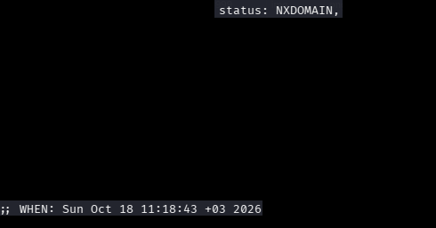

Dated DNS output retains NXDOMAIN and the terminal time, 18 October 2026 11:18:43 +03. The queried name is obscured; its exact spelling could not be established from the original pixels.

**Edits:** Cropped to the result/time region and applied extensive opaque masks to the queried name, DNS transaction details, resolver data and transparent bank/API background. Only the NXDOMAIN result and terminal date strip remain visible.

**Limit:** One resolver response at one time; the exact queried name remains uncertain. This derivative cannot establish a target-domain takedown or DNS change. Removed content is not reconstructed.

## E18

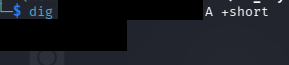

An undated dig A-record query originally showed turkeysystems[.]org resolving to 104[.]21[.]1[.]166 and 172[.]67[.]129[.]163. Live network values are obscured in the image.

**Edits:** Opaque masks cover the queried live domain and both live IP address results. No substitute text or network value is inserted into the image.

**Limit:** No timestamp or resolver is shown. The caption records only the original observation; present-day DNS state and the origin server are not verified.

## E19

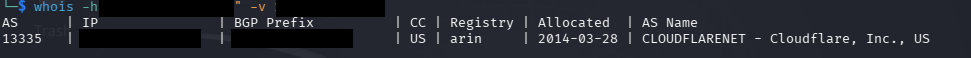

Historical Team Cymru output maps 104[.]21[.]1[.]166 to Cloudflare AS13335. The query domain, IP and BGP prefix are obscured; ASN, network organization and allocation date remain visible.

**Edits:** Opaque masks cover the live lookup-service domain, queried IP, returned IP and BGP network prefix.

**Limit:** Cloudflare is shared proxy infrastructure. This does not identify an origin server, operator or attacker location; the allocation date is not an attack date.

## E20

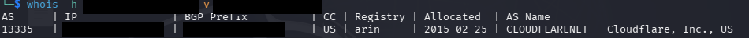

Historical Team Cymru output maps 172[.]67[.]129[.]163 to Cloudflare AS13335. The lookup domain, IP and BGP prefix are obscured.

**Edits:** Cropped out the analyst username/host/path and bottom background. Opaque masks cover the lookup-service domain, queried IP, returned IP and BGP network prefix.

**Limit:** The same shared proxy network as E19; this is not dated DNS or origin-server verification. The network allocation date is not campaign onset.

## E21

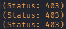

A narrow crop preserves three 403 status examples from historical directory discovery against turkeysystems[.]org. The target, path names and transparent background outside this result column are excluded.

**Edits:** Extensive crop to a small status-code result column removes live target URLs, analyst discovery configuration, path names and the wider transparent code/process background. No text is synthesized.

**Limit:** Only example 403 statuses remain in this derivative. The complete reviewed original contains other redirects/statuses described in the audit. A 403 response does not establish that a sensitive file exists; no raw-response or wildcard check is supplied.

## E22

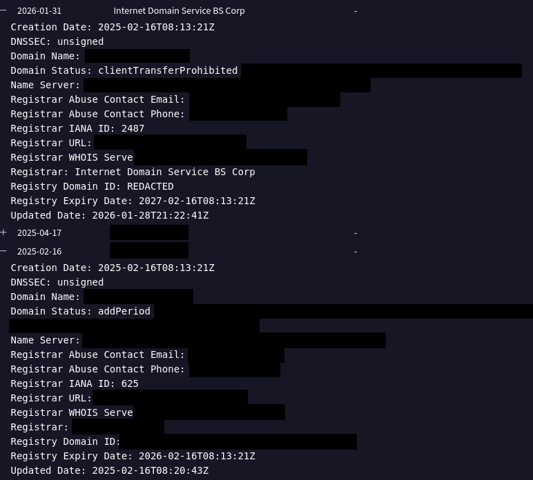

Historical WHOIS for turkeysystems[.]org retains creation, update and expiration dates and non-domain registrar context. Live domains, contact details and registration identifiers are obscured.

**Edits:** Cropped surrounding margins. Opaque masks cover domain names, nameservers, URLs, WHOIS hosts, email/phone contacts, domain-like registrar labels and the registry identifier.

**Limit:** Registration history does not establish attacker identity, first misuse or continuity of ownership. The creation date is not phishing onset.

## E23

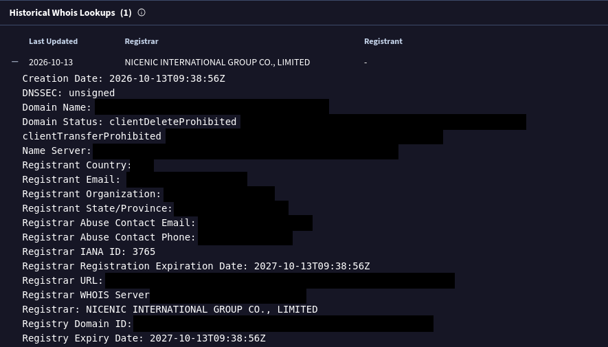

WHOIS for ehazinesorgula[.]com retains the creation time, 13 October 2026 09:38:56 UTC, registrar and expiry context. Domain, registrant/contact values and registration identifiers are obscured.

**Edits:** Cropped margins and applied opaque masks to live domains/URLs/nameservers, registrant country/identifiers, email/phone contacts and registry domain identifiers.

**Limit:** Although the original filename mentions DNS, this image contains WHOIS only. Creation time does not establish the start of phishing; registrant information does not identify an attacker or location.

## E24

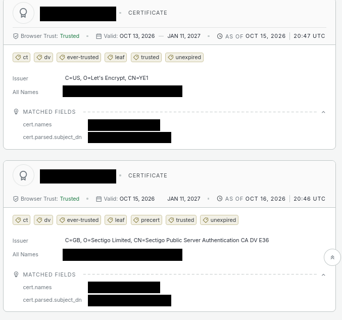

Certificate-search results for ehazinesorgula[.]com and its wildcard retain issuer, validity and as-of dates. The second result is labeled precert; live domain values are obscured.

**Edits:** Opaque masks cover every displayed domain occurrence in titles, SAN names, certificate-name matches and subject fields. Issuer, validity dates and precertificate labeling remain unchanged.

**Limit:** Full certificates and fingerprints are absent. These results do not prove concurrent presentation of both certificates or that the site content was trustworthy.

## E25

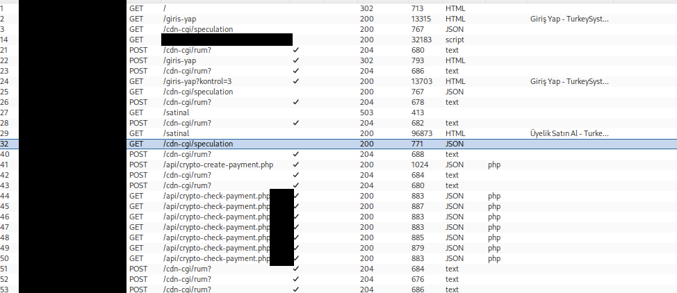

Burp history for turkeysystems[.]org shows membership pages, a crypto-payment creation endpoint and repeated payment-status checks. Live hosts and query tails are obscured.

**Edits:** Cropped out the messaging-profile row and blank lower area. Opaque masks cover all live host values, a telemetry resource identifier and payment-query tails. Methods, endpoint paths and HTTP statuses remain visible.

**Limit:** This is analyst interaction with the external service, not proof of a phishing-victim payment. E26 and E27 are details of the same flow rather than independent corroboration.

## E26

An external-service response dated 22 October 2026 06:41:14 GMT creates a 3.10 USDT/TRC20 membership payment request. Payment token and wallet address are obscured.

**Edits:** Cropped to the JSON response and date-bearing inspector panel, removing request hosts and most telemetry headers. Opaque masks cover remaining tracking headers, the full payment-token value and wallet address. Field names and non-sensitive payment-state context remain visible.

**Limit:** Payment creation is not a completed transfer, wallet-ownership proof or phishing revenue. The expiry field does not state its timezone. The following observed check in E27 remains pending.

## E27

The payment-check JSON reports pending and awaiting payment for 3.10 USDT. It is the continuation of the external-service flow shown in E25 and E26.

**Edits:** Cropped to the JSON status body, excluding request hosts, query fields, cookies/inspector context and all telemetry URLs/tracking headers. No response text is reconstructed.

**Limit:** A pending state is not successful payment or funds transfer. This analyst interaction does not establish a phishing victim, campaign revenue or payment-wallet ownership.

## E28

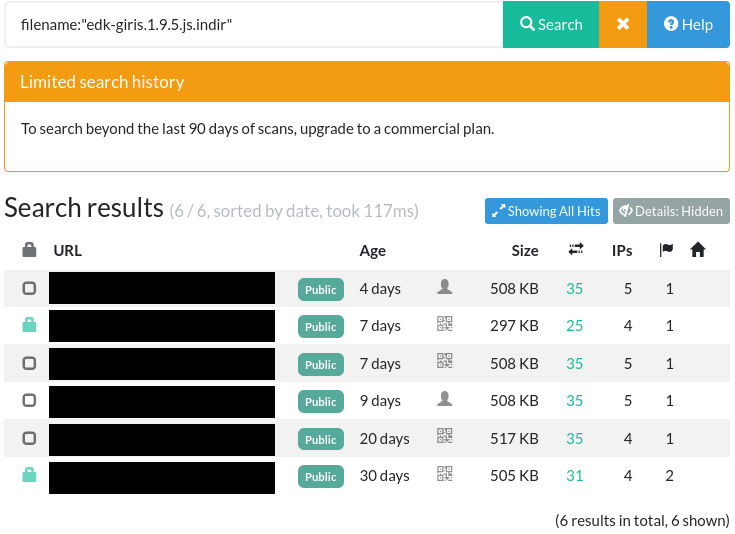

Filename-search candidates: six scan records cover five distinct domains, including two records for gibtakip[.]net. A filename match alone does not establish identical content or a common operator.

**Edits:** Cropped the page header and irrelevant outer margin; applied opaque masks to all six live result URLs. The original filename query, search-history limit, result count, relative ages, sizes, and request/IP counts remain visible.

**Limit:** The query is limited to recent search history. Relative ages lack a reliable screenshot capture time, and no scan UUID or response hash is visible. The domain mapping is supported by the original private evidence, not readable beneath the masks.

## E29

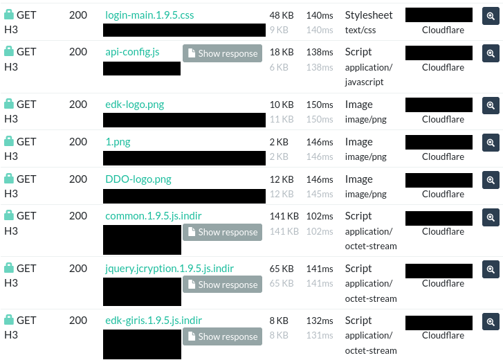

Resource listing attributed to dosyakontrol[.]net shows api-config.js and e-Devlet-style resource filenames returning GET 200. This image does not display the script body or its hash.

**Edits:** Cropped outer margins and the final third-party telemetry row, including its long resource identifier. Applied opaque masks to every remaining live hostname/path label and IP address. Original resource filenames, HTTP methods/status codes, sizes, timings, and Cloudflare provider labels remain visible.

**Limit:** No scan UUID or acquisition date is shown. The resource listing alone does not independently prove the provenance of saved file E30, an identical script body, a common origin server, or a common operator.

## E31

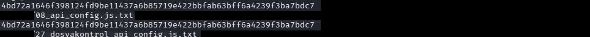

Two-file local SHA-256 comparison: E08 and E30 have the same digest, which was independently recomputed during the audit.

**Edits:** Cropped prompt, command, local-user/host information, and file-listing metadata. Applied opaque masks to the remaining local-directory prefixes, including wrapped prefixes, and irrelevant background areas after the filenames. Original digest values and source filenames are retained.

**Limit:** This establishes equality of two local files, not independent acquisition from two domains. It overlaps the expanded comparisons in E33 and E35.

## E33

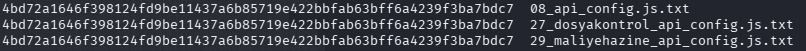

Three-file local SHA-256 comparison: E08, E30, and E32 have the same digest.

**Edits:** Cropped the prompt and command lines, including the local working directory. The three original digest and filename result lines remain unchanged.

**Limit:** This expands E31 to a third local file. Equal hashes do not independently establish acquisition provenance, three-domain deployment, or a common operator.

## E35

Four-file local SHA-256 comparison: E08, E30, E32, and E34 have the same digest. Each file is 18,469 bytes; there is one unique byte content in this group.

**Edits:** Cropped the local-user/host prompt, working directory, command, and its wrapped continuation. The four original digest and filename result lines remain unchanged.

**Limit:** This subsumes the comparisons in E31 and E33. It confirms local byte identity, not independent acquisition from all four attributed domains, full-kit identity, or a common operator.
